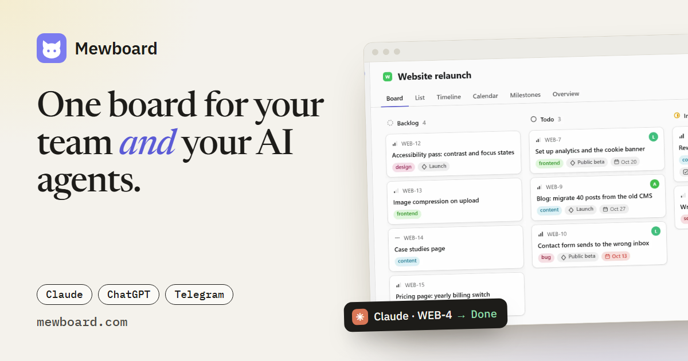
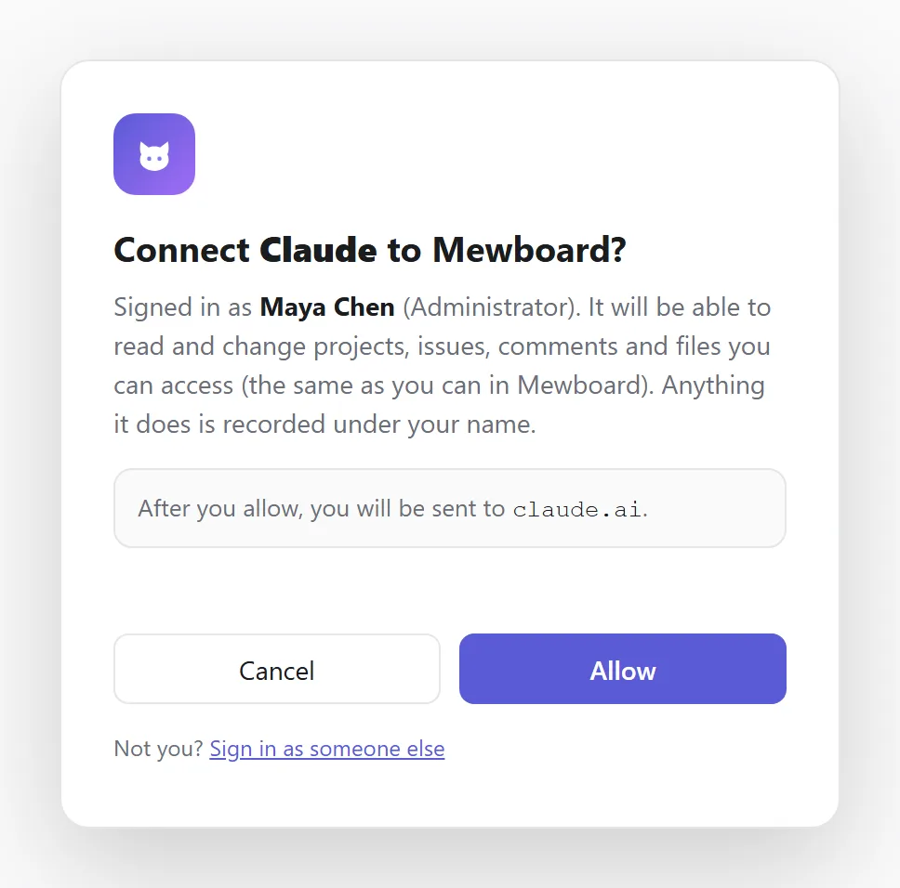
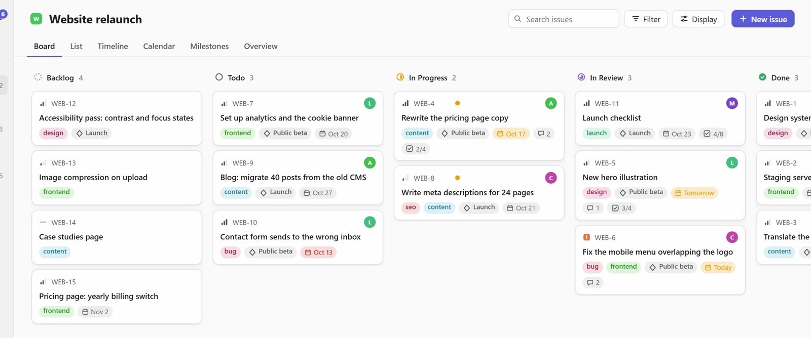

# Mewboard MCP server



[Mewboard](https://mewboard.com) is a project and task board for freelancers, studios and small teams who work with AI assistants. Its hosted MCP server lets Claude, ChatGPT, Cursor or any MCP client read and run your projects, issues, comments, checklists, files, clients and project money, as you, with your role.

This repository documents the hosted server. Mewboard itself is a hosted service: there is nothing to install or run.

| | |
|---|---|
| Endpoint | `https://app.mewboard.com/mcp` |
| Transport | Streamable HTTP |
| Sign-in | OAuth 2.1 with dynamic client registration and PKCE: no API key to copy. Personal access keys exist for scripts. |
| MCP Registry | [`com.mewboard/mewboard`](https://registry.modelcontextprotocol.io/v0.1/servers?search=com.mewboard/mewboard) |
| Docs | [app.mewboard.com/docs/connector.html](https://app.mewboard.com/docs/connector.html) |

## Connect

You need a Mewboard account: [sign up](https://app.mewboard.com/#/signup) (7 days free, no card).

**Claude** (web, desktop app, phone): Settings → Connectors → **Add custom connector** → name `Mewboard`, URL `https://app.mewboard.com/mcp` → Connect → sign in to Mewboard → **Allow**.

**ChatGPT** (paid plans, on the web): Plugins → **Add** → **Add custom MCP server** → name `Mewboard`, URL `https://app.mewboard.com/mcp`, authentication **OAuth** → create → sign in → **Allow**.

**Claude Code**

```bash
claude mcp add --transport http mewboard https://app.mewboard.com/mcp
```

Then run `/mcp` and sign in.

**Cursor** (`~/.cursor/mcp.json`)

```json
{ "mcpServers": { "mewboard": { "url": "https://app.mewboard.com/mcp" } } }
```

**VS Code** (`.vscode/mcp.json`)

```json
{ "servers": { "mewboard": { "type": "http", "url": "https://app.mewboard.com/mcp" } } }
```

The sign-in window asks which workspace the assistant may use. A connection works with that one workspace only.



## What the assistant can do

| Area | Tools |
|---|---|
| Projects and sub-projects | `list_projects`, `get_project`, `read_project`, `create_project`, `update_project` |
| Issues | `list_issues`, `search`, `get_issue`, `read_issue` (everything in one call: fields, comments, file contents), `create_issue`, `update_issue`, `delete_issue` (to the trash), `import_issues` |
| Checklists and comments | `add_checklist`, `update_checklist_item`, `add_comment`, `update_comment` (also pins), `delete_comment` |
| Files | `attach_file`, `list_attachments`, `read_attachment` (images, PDF, Word, Excel, PowerPoint) |
| Planning | milestones, own statuses per project, custom fields (money, payments, formulas), templates, reminders |
| Clients and money | clients, project budget, received and still to receive, a money report by month, project and client |
| People and history | members, notifications, the change history and undo |

Every tool has a title and explicit `readOnlyHint` / `destructiveHint` / `openWorldHint` annotations, so your client can ask before it changes or deletes anything. On connect the server sends a short guide to the model; `get_mewboard_guide` returns it again.



## Try these

- "What is overdue in my Mewboard projects?"
- "Turn this brief into tasks in a new Mewboard project, with a checklist for each stage."
- "Read WEB-12 with all its comments and screenshots and tell me what is blocking it."
- "Which clients still owe me money, and how much?"

## Your data

- The assistant acts **as you**: same role, same projects. A viewer account can only read.
- Everything it changes is recorded under your name and can be undone from the History page.
- Disconnect at any time in Mewboard (My account → Apps connected to my account) or in your assistant's settings.
- Hosted in the EU. [Privacy policy](https://app.mewboard.com/privacy.html) · [Terms](https://app.mewboard.com/terms.html)

## Pricing

7 days free with everything. Then Pro: $12 a month or $99 a year for the whole workspace (not per person), or $149 once for Pro for life. Without a plan a workspace becomes read-only; nothing is deleted.

## Support

[support@mewboard.com](mailto:support@mewboard.com) or open an issue in this repository.
